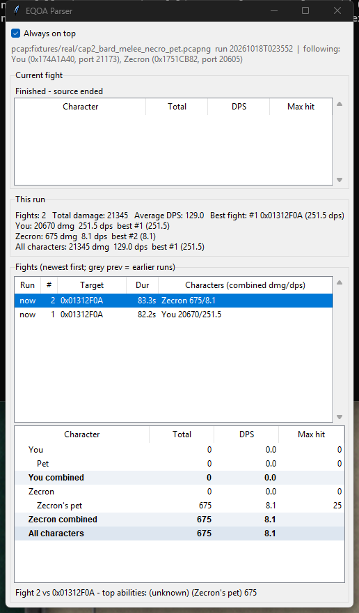

# EQOA Parser

A DPS meter for EverQuest Online Adventures, played on the PCSX2 emulator on the Sandstorm server.

EQOA doesn't have a combat log, so EQOA Parser reads damage from the game server's network traffic instead. These are
the same numbers you see pop up over your target. Each fight shows every character you're playing, their pet, and the
two combined. If you run two emulators at once, both show up.



## Download and run

You don't need Python for this.

1. Download `EQOAParser-<version>.zip` from the [latest release](https://github.com/LoopRook/EQOA-Parser/releases/latest) and unzip it anywhere.
2. In PCSX2, open Settings → Network & HDD, enable Ethernet, and set the device type to **Sockets**.
3. Double-click `EQOAParser.exe`. Windows will probably say "Windows protected your PC" because the program isn't
   code-signed; click **More info**, then **Run anyway**. Then say yes to the Administrator prompt. Windows only lets
   administrators read network traffic, and that's the only reason the meter asks for it.
4. Play. A fight starts with the first hit and ends after 8 seconds with no damage dealt or taken.

The zip also has a `READ-ME-FIRST.txt` with the same steps, if you're passing it on to someone.

## What you see

The current fight lists each character as three rows: the character, their pet, and the two combined, with total
damage, DPS and biggest hit. With two emulators running there's also an "All characters" line.

Below that is a list of past fights showing the target, how long it lasted, and each character's damage. Click a fight
to see its full breakdown and top hits. The run summary at the top gives each character's total, DPS and best fight.

Fights are saved to `runs/<date>.json` next to the program and load back in if you restart it the same day. The window
stays on top of other windows by default. There's also a console mode (`--no-gui`).

Start the meter before you log in or zone if you can. Names for characters and monsters come from data the server sends
when they first appear, so anything already on screen when the meter starts shows up as an ID like `0x01312F0A` until it
comes back into view.

## Is it safe?

The meter only listens to the traffic between your PC and the Sandstorm server (`5.161.217.188`). It doesn't send
anything, and it doesn't read or change the emulator or the game. The only thing it writes is the fight summaries, on
your own PC; nothing gets uploaded. It needs Administrator rights because Windows won't show network packets to a
normal program.

It's a passive tool, but it's still worth checking Sandstorm's rules on third-party programs before you use it.

## Two emulators

Just run both. The meter follows every copy of PCSX2 talking to the server and gives each character their own rows. If
you only want one, pass its connection port (shown in the status line): `EQOAParser.exe --connection 20605`.

## If it shows nothing

Check that PCSX2's network is set to Sockets and that you said yes to the Administrator prompt. If you're on a VPN or
your PC has more than one network adapter, open `config.yaml` (next to the exe) and set `interface_ip` to your PC's IPv4
address. If Sandstorm ever moves to a new address, change `server_ip` in the same file.
[docs/live-capture.md](docs/live-capture.md) has more troubleshooting.

## Known limitations

This is an early version and it has only been tested on one PC. The packet format was pieced together from real game
captures, so some of it is educated guesswork.

- Monsters that were already on screen when the meter started show as IDs instead of names.
- Spell and ability names aren't decoded yet; they show as "(unknown)".
- Group members on other people's PCs aren't shown yet, only characters on your own emulators.

If you're curious how the packets were decoded and which parts are confirmed, see [docs/protocol-notes.md](docs/protocol-notes.md).

## Roadmap

1. Names for monsters that were already on screen.
2. Spell and ability names.
3. Damage from group members on other PCs.
4. A transparent overlay you can click through.

## Running from source

You'll need Python 3.11 or newer on Windows.
```
pip install -r requirements.txt
python -m eqoa_parser --live          # needs an Administrator terminal; or double-click run-live.bat
python -m eqoa_parser --pcap file.pcapng --no-gui   # replay a saved capture, no admin needed
python -m eqoa_parser --help
```
To run the tests, install `requirements-dev.txt` and run `python -m pytest -q`. They use two real captures in
`fixtures/real/`, trimmed down to the server's packets only. To build the exes and the zip, run `packaging\build-exe.bat`;
everything ends up in `dist\`. The design notes are in [docs/CONTRACTS.md](docs/CONTRACTS.md), and the test and
verification history is in [docs/VERIFICATION.md](docs/VERIFICATION.md).

If you record your own capture for debugging (the `pktmon` steps are in [docs/live-capture.md](docs/live-capture.md)),
don't post it publicly. Captures include your own login traffic.

## License

GPL-3.0; see [LICENSE](LICENSE).

This is an unofficial fan project. It isn't affiliated with or endorsed by Sony, Daybreak Game Company, the PCSX2
project, or the Sandstorm server team. EverQuest is a trademark of its owner.
