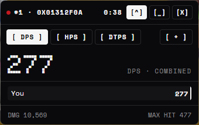
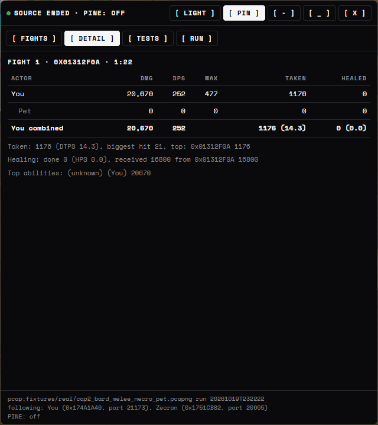
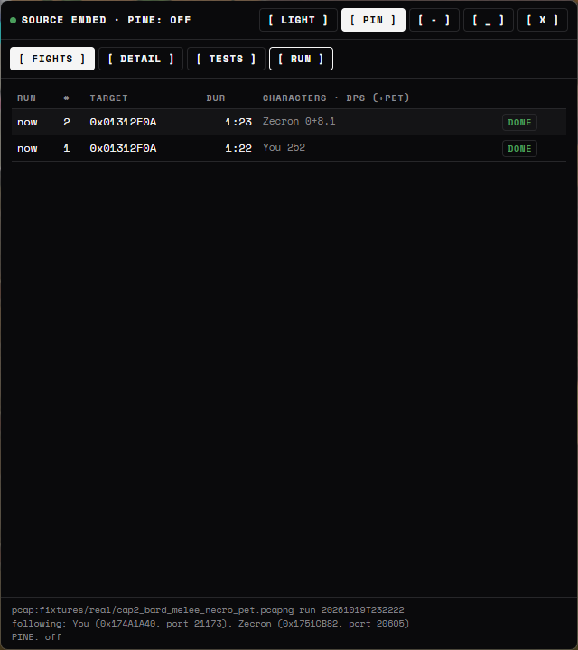

# EQOA Parser

A damage meter for EverQuest Online Adventures on PCSX2, for players on the Sandstorm server. It shows the damage,
healing and damage taken of you and your pet in each fight, tracks kills, XP and tunar per hour, works with two emulators
running at once, and has a timed test mode for comparing pets or gear on a dummy.

<p>


</p>

## Download and run

1. Download `EQOAParser-<version>.zip` from the [latest release](https://github.com/LoopRook/EQOA-Parser/releases/latest) and unzip it anywhere.
2. In PCSX2, open Settings → Network & HDD, enable Ethernet, and set the device type to **Sockets**.
3. Double-click `EQOAParser.exe`. Windows will probably say "Windows protected your PC" because the program isn't
   code-signed; click **More info**, then **Run anyway**. Then say yes to the Administrator prompt (the safety section
   below explains why it asks).
4. Play. A fight starts with the first hit and ends after 8 seconds with no damage dealt or taken.

The zip also has a `READ-ME-FIRST.txt` with the same steps, if you're passing it on to someone.

## What you see

The meter opens as a small window that stays on top of the game. The big number is your combined DPS, and the switch
above it changes the view to **HPS** (healing) or **DTPS** (damage taken per second). Below it, every character gets a
bar, with their pet's bar underneath. Drag the window by its header; **[^]** pins it on top, **[+]** opens the full view.

The full view has four tabs:
- **Fights:** every fight with its target, length and each character's DPS (pet included).
- **Detail:** the selected fight per character and pet: damage, DPS, biggest hit, damage taken (with DTPS and who hit
  you) and healing done (with HPS) and received (with who healed you).
- **Tests:** timed tests and their results (see below).
- **Run:** totals for this session per character, plus kills, XP, class mastery XP and tunar, each also per hour.

Light and dark themes follow Windows, with a toggle. Fights are saved to `runs/<date>.json` next to the program and
load back in if you restart it the same day. There's also a console mode (`--no-gui`), and the older plain window is
still there as `--classic`.



Start the meter before you log in or zone if you can. Names for characters and monsters come from data the server sends
when they first appear, so anything already on screen when the meter starts shows up as an ID like `0x01312F0A` until it
comes back into view.

## Safety and privacy

The meter listens to the traffic between your PC and the Sandstorm server (`5.161.217.188`) and never sends anything.
It never changes the emulator or the game. Without PINE it doesn't touch the emulator at all; with PINE on it reads the
emulator's memory for names and your group, and never writes to it. Everything it saves (fights, test results, and
recordings if you make any) stays on your PC; nothing gets uploaded. It needs Administrator rights because Windows
won't show network packets to a normal program.

It's a passive tool, but it's still worth checking Sandstorm's rules on third-party programs before you use it.

## Recording a fight

If something looks wrong, press **Record**, play until it happens, and press **Mark** to note the moment. The file in
the `captures` folder next to the exe only holds what the server sent you, so it's safe to send to whoever is helping
you look into it.

## Testing on a dummy

Fights end after a few quiet seconds, so their lengths vary and pauses pull the DPS down. For comparing pets, gear or
spells, press **Test**, name it (for example "Djinni Vizier 1"), keep the length at 180 seconds and start hitting the
dummy. The clock starts at your first damage and DPS is total damage divided by the full length, so every run is
measured the same way. Keep the setup identical, do three runs of each thing and compare them. Results appear in the
Tests list with the per-character breakdown, are saved in `runs/<date>.json`, and show the pet's name when PINE is on.
From a terminal, `--no-gui --test 180 --test-label "Djinni Vizier 1"` runs one test.

## Two emulators

The meter follows every copy of PCSX2 talking to the server and gives each character their own rows. If you only want
one, pass its connection port (shown in the status line): `EQOAParser.exe --connection 20605`.

## Optional: names straight away (PINE)

With PINE on, the meter reads names from the emulator's memory (read-only), so your characters, your pet and the
monsters around you are named from the start instead of after your first zone. Fights and tests also show your pet's
name, like "Maige's pet (Djinni Vizier)".

Groupmates' damage can't be shown, with or without PINE: the server only sends your PC the hits that involve your own
character or pet. Heals a groupmate casts on you do show up, by name.

1. In PCSX2, open Settings → Advanced, turn on PINE, and note the slot number (28011 by default).
2. Run `EQOAParser.exe --pine` (add `--pine-slot 28012` if your slot isn't the default), or put this in `config.yaml`:
   `pine: {enabled: true, slot: 28012}`.

The status line shows `PINE: on (slot 28012)`, or `PINE: not reachable` if PCSX2 isn't answering; the meter keeps
working either way and retries every few seconds. PCSX2 copies share one settings file, so only one emulator can have
PINE on at a time.

## If it shows nothing

Check that PCSX2's network is set to Sockets and that you said yes to the Administrator prompt. If you're on a VPN or
your PC has more than one network adapter, open `config.yaml` (next to the exe) and set `interface_ip` to your PC's IPv4
address. If Sandstorm ever moves to a new address, change `server_ip` in the same file.
[docs/live-capture.md](docs/live-capture.md) has more troubleshooting.

## Known limitations

This is an early version and it has only been tested on one PC. The packet format was pieced together from real game
captures, so some of it is educated guesswork.

- Only your own characters and pets are measured. The server never sends other players' damage.
- Fighting several mobs at once counts as one fight, named after the mob that took the most damage. There's no per-mob
  breakdown yet.
- Without PINE, monsters that were already on screen when the meter started show as IDs instead of names.
- Spell and ability names aren't decoded yet, and misses, resists and deaths aren't detected.

Notes on how the packets were decoded, and which parts are confirmed, are in [docs/protocol-notes.md](docs/protocol-notes.md).

## Roadmap

1. A per-mob breakdown for fights against several mobs.
2. The DPS / HPS / DTPS switch in the full view too.
3. PINE switching on by itself when PCSX2 has it enabled.
4. Names for monsters that were already on screen, without needing PINE.
5. Spell and ability names.

## Running from source

You'll need Python 3.11 or newer on Windows.
```
pip install -r requirements.txt
python -m eqoa_parser --live          # needs an Administrator terminal; or double-click run-live.bat
python -m eqoa_parser --pcap file.pcapng --no-gui   # replay a saved capture, no admin needed
python -m eqoa_parser --help
```
To run the tests, install `requirements-dev.txt` and run `python -m pytest -q`. They use three real captures in
`fixtures/real/`, trimmed down to the server's packets only with `tools/sanitize_pcapng.py`. To build the exes and the
zip, run `packaging\build-exe.bat`; everything ends up in `dist\`. `packaging\build-prerelease.bat` builds a test copy
in `prerelease\` with PINE already switched on. The design notes are in [docs/CONTRACTS.md](docs/CONTRACTS.md), and the test and
verification history is in [docs/VERIFICATION.md](docs/VERIFICATION.md).

If you record your own capture for debugging (the `pktmon` steps are in [docs/live-capture.md](docs/live-capture.md)),
don't post it publicly. Captures include your own login traffic.

## License

GPL-3.0; see [LICENSE](LICENSE).

This is an unofficial fan project. It isn't affiliated with or endorsed by Sony, Daybreak Game Company, the PCSX2
project, or the Sandstorm server team. EverQuest is a trademark of its owner.
